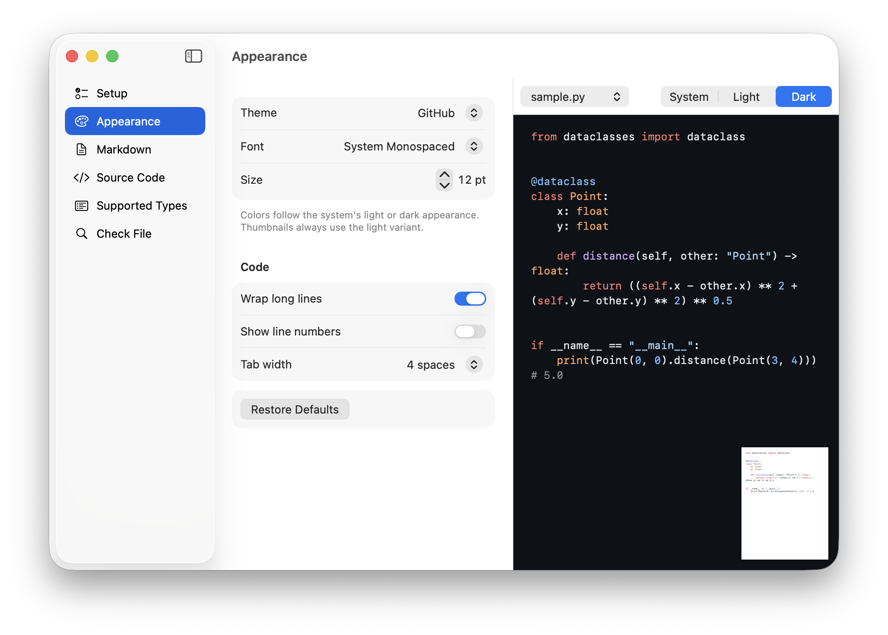

# Peek

Quick Look previews for Markdown and source code, and Finder thumbnails for source code, on macOS 26.

  

## What it does

- **Preview** (Space in Finder): source code is shown with syntax highlighting. Markdown is rendered, including tables, task lists, strikethrough, links, local images and highlighted code blocks.
- **Thumbnails**: Finder icons show the start of the file as highlighted text on a page in the theme's light or dark colours. Markdown (`.md`, `.markdown`), JSON and assembly (`.s`) files get macOS's own plain-text thumbnails instead: macOS uses its built-in thumbnailers for these types, and neither Peek nor the user can switch them off.

Highlighting uses [highlight.js](https://highlightjs.org) and Markdown parsing uses [swift-markdown](https://github.com/swiftlang/swift-markdown).

## Settings

| Setting | Options | Default |
|---|---|---|
| Theme | Xcode, GitHub; each in light and dark | Xcode |
| Appearance | System (follows macOS light/dark), light, dark | System |
| Dark thumbnails | On / off; thumbnails don't follow the system appearance | Off |
| Thumbnail text | Small, medium, large, very large | Large |
| Font, size | Any installed font, 8–28 pt | System monospaced, 12 pt |
| Wrap long lines, line numbers | On / off | Wrap on, numbers off |
| Tab width | 2, 4, 8 spaces | 4 |
| Highlight up to | 100 KB – 1 MB; larger files are cut off at this size | 200 KB |
| Markdown front matter | Shown as a table / hidden | Shown |
| Raw HTML in Markdown | Cleaned up (scripts, styles and remote content removed) / shown as text | Cleaned up |
| Remote images in Markdown | Load / block | Block |

Finder keeps thumbnails it has already made until the file changes. After changing thumbnail settings, click Refresh… under Appearance: Peek clears the thumbnail cache and relaunches Finder.

## Supported formats

`.bash` `.c` `.c++` `.cc` `.cjs` `.clj` `.cljc` `.cljs` `.cmake` `.containerfile` `.cp` `.cpp` `.cs` `.csh` `.css` `.cxx` `.dart` `.diff` `.dockerfile` `.edn` `.erl` `.ex` `.exs` `.fish` `.gmk` `.go` `.gql` `.gradle` `.graphql` `.groovy` `.h` `.h++` `.hh` `.hp` `.hpp` `.hrl` `.hs` `.hxx` `.ini` `.inl` `.ipp` `.jav` `.java` `.javascript` `.js` `.jscript` `.json` `.json5` `.jsonc` `.jsx` `.ksh` `.kt` `.kts` `.less` `.lhs` `.lua` `.m` `.mak` `.make` `.markdown` `.md` `.mdown` `.mjs` `.mk` `.mkd` `.mkdn` `.ml` `.mli` `.mm` `.nix` `.patch` `.ph3` `.ph4` `.php` `.php3` `.php4` `.phtml` `.pl` `.pm` `.proto` `.py` `.rb` `.rbw` `.rc` `.rs` `.s` `.sc` `.scala` `.scss` `.sh` `.sql` `.svelte` `.swift` `.swiftinterface` `.tcsh` `.toml` `.tsx` `.vue` `.xml` `.yaml` `.yml` `.zsh`

## Privacy and permissions

- Peek makes no network requests and collects no data.
- All parts of Peek are sandboxed. The preview extension may read any file (read-only), so that Markdown files can show the local images they reference.
- The settings app has the outgoing network entitlement only because its live preview (`WKWebView`) doesn't start in a sandboxed app without it.
- The settings app may send Apple Events to Finder, only to relaunch it when you refresh thumbnails. macOS asks for permission the first time.
- The settings app may read a file you pick under Check File, to show its type.
- Quick Look previews run scripts and may load remote content. Peek therefore escapes source code, cleans up or escapes HTML in Markdown, and blocks remote images unless you enable them. Details: [docs/DEVELOPMENT.md](docs/DEVELOPMENT.md#security).

## Install

Requires macOS 26.

1. Download `Peek-<version>.dmg` from [Releases](https://github.com/1nilsh/peek/releases) and drag Peek into Applications. Releases are signed with a Developer ID and notarized by Apple.
2. Open Peek once so macOS registers its extensions.
3. Enable Peek under Quick Look in System Settings → General → Login Items & Extensions.

To build from source, see [docs/DEVELOPMENT.md](docs/DEVELOPMENT.md).

## Documentation

- [Development](docs/DEVELOPMENT.md): layout, build, architecture, security model, adding a format
- [Testing](docs/TESTING.md): automated tests and manual Quick Look checklist
- [Releasing](docs/RELEASING.md): signed and notarized DMG releases via GitHub Actions
- [Changelog](CHANGELOG.md)

## License

MIT, see [LICENSE](LICENSE). Bundled dependencies: [THIRD_PARTY_NOTICES.md](THIRD_PARTY_NOTICES.md).
